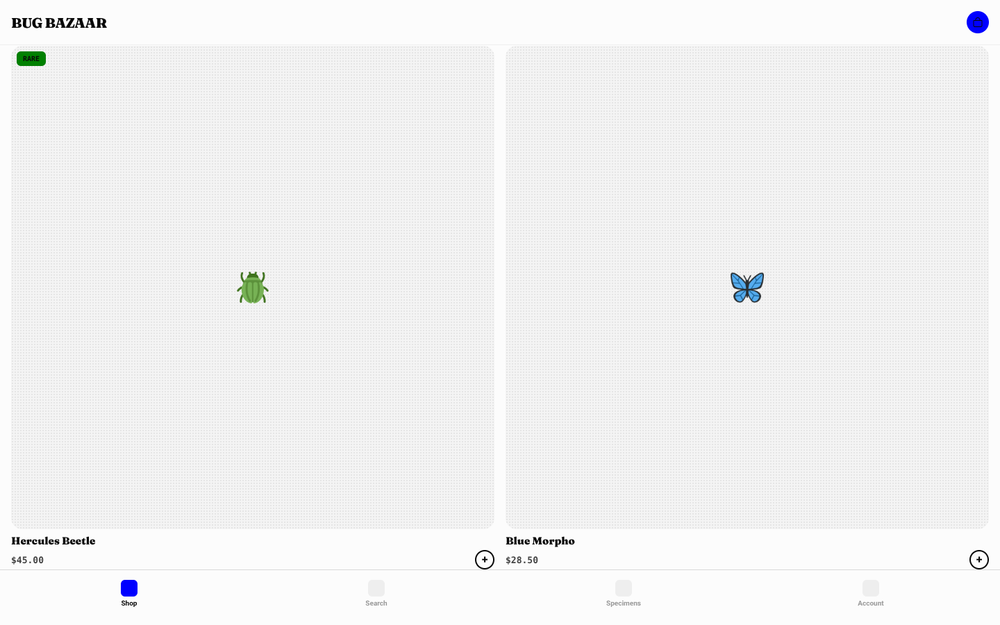
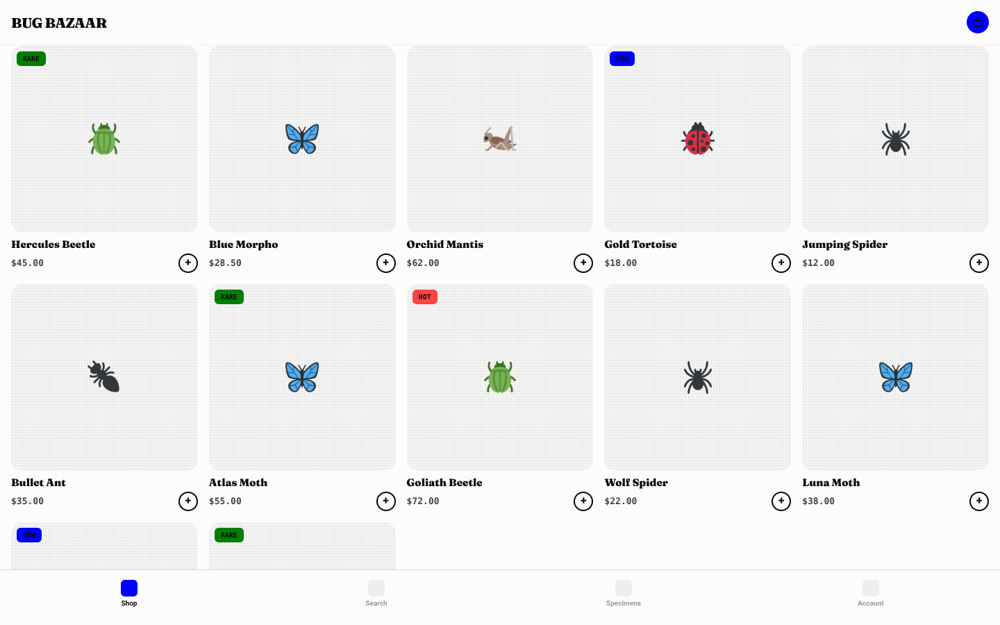

# Shop grid on wide browser windows

On a desktop browser the shop grid fits as many product cards per row as the window allows: two on phones, three from 600 px, four from 900 px and five from 1200 px. A 1440x900 window shows five cards per row instead of two giant ones.

## Before

## After

